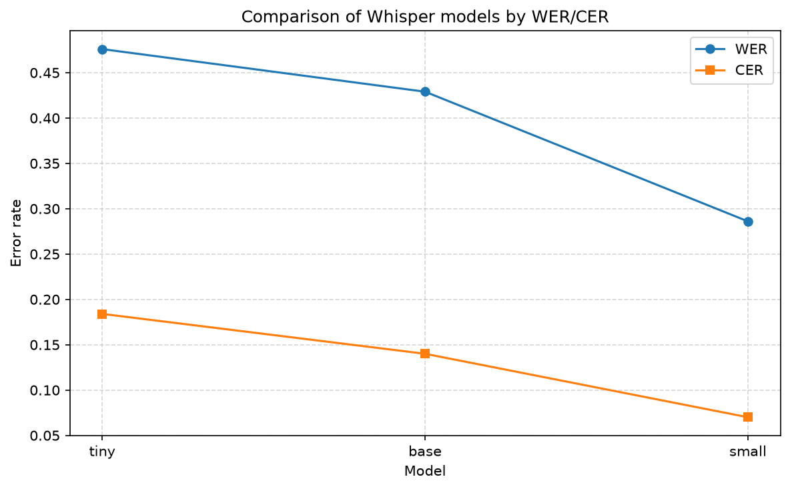

# Whisper ASR eval: русские голосовые команды

Сравнение моделей Whisper (tiny, base, small) на коротких русских командах для голосовой колонки: точность распознавания (WER, CER) и задержка на CPU.

Это первый модуль проекта `smart-speaker`. Следующие этапы: классификатор интентов и сборка ассистента.

## Результаты

Данные: 6 записей (один диктор, команды 2-3,5 с), 21 слово в эталонах. Запуск на CPU, ноутбук без дискретной видеокарты (Intel Iris Plus).

| Модель | WER | CER | Время на фразу, с (медиана, 2 запуска) |
|---|---|---|---|
| tiny | 0,476 | 0,184 | 1,1-1,5 |
| base | 0,429 | 0,140 | 2,5-2,8 |
| small | 0,286 | 0,070 | 7,4-7,8 |

WER считается по корпусу: все ошибки делятся на общее число слов в эталонах. Метрики качества в обоих запусках совпали (результат детерминирован), время слегка плавает от запуска к запуску, поэтому указан диапазон медиан.




### Результаты по файлам

| Эталон | tiny | base | small |
|---|---|---|---|
| разбуди меня в 18:37 | Разбудем меня в 1837. | Разбудем меня 1837. | Разбуди меня в 1837. |
| поставь таймер на 5 минут | Вставь таймер на 5 минут. | Ставь таймер на 5 минут. | Поставь таймер на 5 минут. |
| запусти браузер | Запусти бралвер. | Запусти браузер. | Запусти браузер. |
| сделай звук тише | Сделай звук потюже. | Сделай звук потиши. | Сделаю звук потише. |
| сделай звук громче | Делый зуб по громче. | Делай зуб по громче. | Делаю звук погромче. |
| какая сегодня погода | Какая сегодня порбона. | Какая сегодня погода? | Какая сегодня погода? |

## Выводы

1. **Small точнее остальных.** WER 0,286 против 0,476 (tiny) и 0,429 (base), CER 0,07. Три файла из шести она распознала без ошибок.
2. **Tiny и base почти не различаются.** Разница между ними 1 слово из 21, на такой выборке это неотличимо от случайности.
3. **Tiny искажает ключевые слова команд** («погода» → «порбона», «браузер» → «бралвер»). Для колонки это критично: команда не будет понята.
4. **Small ошибается иначе:** меняет форму глагола («сделай» → «сделаю»). Смысл команды сохраняется, поэтому классификатор интентов, возможно, справится с такими ошибками (будет проверено на этапе NLU).
5. **Числа.** Все модели пишут время цифрами слитно («1837» вместо «18:37»). Это нужно обрабатывать отдельно на этапе NLU.
6. **Задержка.** Small тратит около 7,5-8 с на команду (медиана), и это для интерактивного ассистента на CPU слишком много. Время почти не зависит от длины записи (Whisper обрабатывает аудио окнами по 30 с), поэтому для коротких команд RTF получается больше 1, и корректнее сравнивать абсолютное время.

**Выбор модели:** small как эталон по качеству. Для интерактивной работы на CPU нужна оптимизация (см. ниже), иначе придётся выбирать между точностью и задержкой.

## Ограничения

- Малая выборка: 6 записей, 21 слово, один диктор, без шумового фона. Один неверно распознанный файл заметно меняет WER.
- В файле с временем WER частично завышен форматом числа («18:37» против «1837»), а не ошибкой распознавания.
- Время измерено на одном ноутбуке (двух запусках) и зависит от нагрузки: среднее у small в разных запусках 7,5 и 9,4 с из-за отдельных медленных вызовов, поэтому используется медиана. Время загрузки модели не приводится: оно нестабильно (у small 4,7 и 24,6 с).

## Дальнейшие шаги

- Увеличить набор до 30-50 фраз с шумом и разной скоростью речи.
- Нормализовать числа и время перед подсчётом WER.
- Ускорить small (например, faster-whisper с int8-квантизацией) и перемерить задержку.
- Добавить казахский язык.
- Проверить, как ошибки ASR влияют на точность классификатора интентов.

## Как запустить

```bash
python -m venv .venv
.venv\Scripts\activate          # Windows
pip install -r requirements.txt
```

Откройте `notebooks/01_asr_whisper_eval.ipynb` и выполняйте ячейки сверху вниз. Первая ячейка подключает ffmpeg через `imageio-ffmpeg`, отдельная установка не нужна. Записи лежат в `data/my_recordings/`, метрики пишутся в `results/` через запуск в терминале `python -m src.run_eval --models tiny base small`.

## Структура

```
asr-eval/
├── data/my_recordings/    # записи команд
├── notebooks/             # эксперименты и графики
├── src/asr.py             # load_asr, transcribe, load_audio
└── results/               # summary.csv, results_per_file.csv, графики
```
