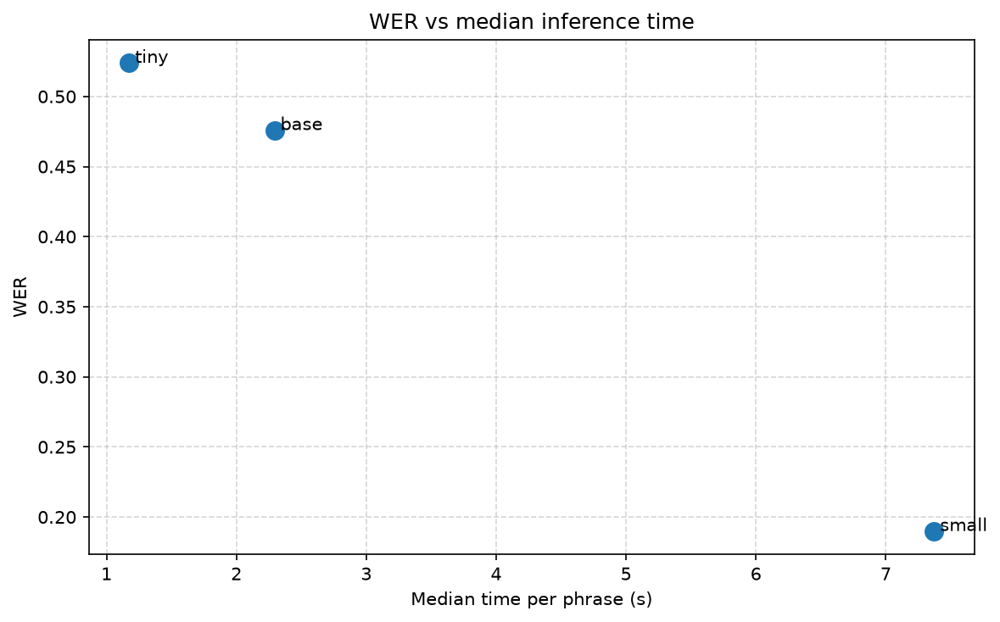

# Whisper ASR eval: русские голосовые команды

Сравнение моделей Whisper (tiny, base, small) на коротких русских командах для голосовой колонки: точность распознавания (WER, CER) и задержка на CPU.

Это первый модуль проекта `smart-speaker`. Следующие этапы: классификатор интентов и сборка ассистента.

## Результаты

Данные: 6 записей (один диктор, команды 2-3,5 с), 21 слово в эталонах. Запуск на CPU, ноутбук без дискретной видеокарты (Intel Iris Plus). CPU / RAM / версии Python и torch: `<заполнить>`.

| Модель | WER | CER | Время на фразу, с (медиана) |
|---|---|---|---|
| tiny | 0,524 | 0,144 | 1,17 |
| base | 0,476 | 0,102 | 2,29 |
| small | 0,190 | 0,034 | 7,37 |

WER считается по корпусу: все ошибки делятся на общее число слов в эталонах. Время: медиана из 3 замеров на фразу после прогрева модели, затем медиана по файлам. Качество распознавания детерминировано, время зависит от нагрузки на ноутбук.




### Результаты по файлам

| Эталон | tiny | base | small |
|---|---|---|---|
| разбуди меня в 18:37 | Разбудем меня в 1837. | Разбудем меня 1837. | Разбуди меня в 1837. |
| поставь таймер на 5 минут | Вставь таймер на 5 минут. | Ставь таймер на 5 минут. | Поставь таймер на 5 минут. |
| запусти браузер | Запусти бралвер. | Запусти браузер. | Запусти браузер. |
| сделай звук потише | Сделай звук потюже. | Сделай звук потиши. | Сделаю звук потише. |
| сделай звук погромче | Делый зуб по громче. | Делай зуб по громче. | Делаю звук погромче. |
| какая сегодня погода | Какая сегодня порбона. | Какая сегодня погода? | Какая сегодня погода? |

## Выводы

1. **Small заметно точнее остальных.** WER 0,190 против 0,524 (tiny) и 0,476 (base), CER 0,034. Три файла из шести распознаны без ошибок. Все 4 ошибочных слова у small не меняют смысла команды: 2 из них приходятся на формат числа («18:37» против «1837»), ещё 2 на форму глагола («сделай» → «сделаю», «делаю»).
2. **По WER tiny и base различаются на одно слово из 21** (11 и 10 ошибок), что на такой выборке неотличимо от случайности. По качеству ключевых слов разница есть: base правильно распознала «браузер» и «погода», tiny исказила оба слова.
3. **Tiny искажает ключевые слова команд** («погода» → «порбона», «браузер» → «бралвер»). Для колонки это критично: команда не будет понята.
4. **Все модели путаются на слове «погромче»:** tiny и base разбивают его на «по громче» и искажают соседние слова. Small справляется.
5. **Числа.** Все модели пишут время цифрами слитно («1837» вместо «18:37»). Это нужно обрабатывать отдельно на этапе NLU.
6. **Задержка.** Small тратит около 7,4 с на команду (медиана), и это для интерактивного ассистента на CPU слишком много. Время почти не зависит от длины записи (Whisper обрабатывает аудио окнами по 30 с), см. `audio_s` и `time_s` в `results/results_per_file.csv`.

**Выбор модели:** small как эталон по качеству. Для интерактивной работы на CPU нужна оптимизация (см. ниже), иначе придётся выбирать между точностью и задержкой. Проверить, насколько ошибки ASR влияют на понимание команд, предстоит на этапе классификатора интентов.

## Ограничения

- Малая выборка: 6 записей, 21 слово, один диктор, без шумового фона. Одно слово меняет WER примерно на 4,8 п.п.
- В файле с временем WER завышен форматом числа («18:37» против «1837»), а не ошибкой распознавания.
- Время измерено на одном ноутбуке (CPU, без GPU) и зависит от нагрузки. У small на двух файлах время составило 12-13 с вместо типичных 6,5-8 с: три замера подряд не защищают от замедления, которое длится дольше самих замеров. Время загрузки модели не приводится как нестабильное.

## Дальнейшие шаги

- Увеличить набор до 30-50 фраз с шумом и разной скоростью речи, добавить проверку на открытом датасете.
- Нормализовать числа и время перед подсчётом WER.
- Ускорить small (например, faster-whisper с int8-квантизацией) и перемерить задержку.
- Добавить казахский язык.
- Проверить, как ошибки ASR влияют на точность классификатора интентов.

## Как запустить

```bash
python -m venv .venv
.venv\Scripts\activate          # Windows
pip install -r requirements.txt
python -m src.run_eval --models tiny base small
```

Запускать из папки `asr-eval`. Скрипт читает записи из `data/my_recordings/` и эталоны из `data/references.csv`, метрики пишет в `results/`. ffmpeg отдельно ставить не нужно, он берётся из `imageio-ffmpeg`. Графики строит ноутбук `notebooks/01_asr_whisper_eval.ipynb` по готовым CSV.

## Структура

```
asr-eval/
├── data/
│   ├── my_recordings/     # записи команд
│   └── references.csv     # эталонные тексты
├── notebooks/             # графики и разбор ошибок
├── src/
│   ├── asr.py             # load_asr, load_audio, transcribe
│   ├── metrics.py         # нормализация, WER, CER
│   └── run_eval.py        # прогон моделей → results/*.csv
└── results/               # summary.csv, results_per_file.csv, графики
```
