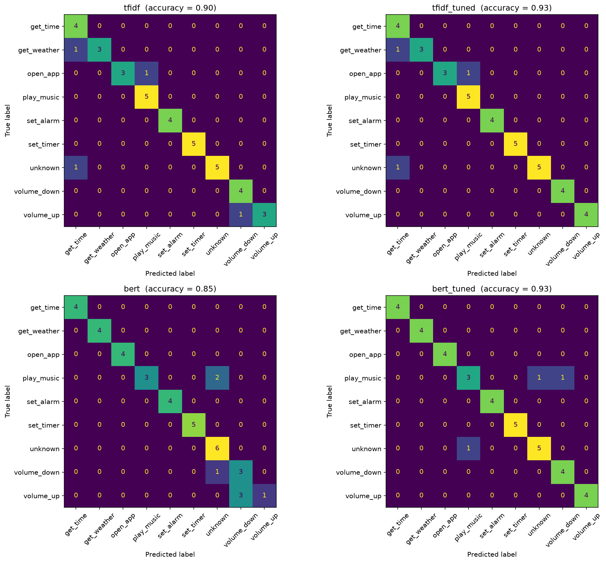

# Intent classifier: TF-IDF против rubert-tiny2

Классификатор интентов для голосовой колонки: по тексту команды («поставь таймер на 10 минут») определяет, чего хочет пользователь (`set_timer`). Сравниваются две модели на трёх тестах, включая реальные выходы Whisper.

Это второй модуль проекта `smart-speaker`, он продолжает [`asr-eval`](../asr-eval).

## Данные

- 196 коротких русских фраз, 9 классов: `set_timer`, `set_alarm`, `play_music`, `volume_up`, `volume_down`, `get_weather`, `get_time`, `open_app` и `unknown` (посторонние фразы вроде «расскажи анекдот»).
- Набор составлен вручную с помощью LLM и проверен автором (`data/intents.csv`).
- Разбиение: 156 фраз в train и 40 в test (`train_test_split`, `stratify`, `random_state=42`). Пересечений train и test нет.
- `data/hard_asr.csv`: 18 строк, то, что выдали Whisper tiny, base и small на шести записанных командах. В обучение они не входят.

## Модели

| Модель | Как строится вектор фразы | Что обучается |
|---|---|---|
| TF-IDF + логистическая регрессия (бейзлайн) | слова и пары слов | только логрегрессия |
| rubert-tiny2 + логистическая регрессия | вектор `[CLS]` готовой модели (312 чисел), модель заморожена | только логрегрессия |

Параметр регуляризации `C` подбирался для обеих моделей одинаково, кросс-валидацией внутри train (тест при этом не использовался). Версии с подбором помечены `tuned`: у TF-IDF лучший `C = 10`, у rubert-tiny2 `C = 1000` (край сетки значений).

## Результаты

| Модель | Accuracy на test (40) | Macro-F1 на test | CV accuracy (5×3 вложенная) | ASR: tiny | ASR: base | ASR: small | мс на фразу |
|---|---|---|---|---|---|---|---|
| TF-IDF (C=1) | 0,900 | 0,898 | 0,808 ± 0,055 | 0,83 | 1,00 | 1,00 | 1,5 |
| TF-IDF (подбор C) | 0,925 | 0,926 | 0,825 ± 0,052 | 0,83 | 1,00 | 1,00 | 1,5 |
| rubert-tiny2 + LR (C=1) | 0,850 | 0,839 | 0,843 ± 0,055 | 0,33 | 0,67 | 0,67 | 7,2 |
| rubert-tiny2 + LR (подбор C) | 0,925 | 0,932 | **0,898 ± 0,037** | 0,67 | 0,67 | 0,83 | 7,2 |

Колонки «ASR» это доля верных интентов на 6 фразах, полученных от соответствующей модели Whisper. Время: медиана на одну фразу на CPU без учёта Whisper.



## Выводы

1. **Подбор `C` важен для обеих моделей.** При `C=1` регуляризация слишком сильная: macro-F1 на кросс-валидации train у TF-IDF 0,66 против 0,75 при `C=10`, у rubert-tiny2 0,80 против 0,885 при `C=1000`.
2. **На данных своего стиля лучше rubert-tiny2:** 0,898 ± 0,037 против 0,825 ± 0,052 у TF-IDF по кросс-валидации. На тесте из 40 фраз обе версии с подбором `C` одинаковы (по 3 ошибки), поэтому одно разбиение разницы не показывает. Оно и завышает оценку: у TF-IDF 0,925 на test против 0,825 по кросс-валидации.
3. **На выходах Whisper лучше TF-IDF:** 17 из 18 верных против 13 из 18 у rubert-tiny2 (подбор `C`). Основная причина: все три записи про будильник со временем «1837» (цифры слитно, так их пишет Whisper) rubert-tiny2 отнёс к `volume_up`, а TF-IDF опирался на слова «разбуди меня в». Так что ни одна модель не лучше во всём, результат зависит от теста.
4. **Разные типы ошибок.** TF-IDF путается из-за общих слов («включи камеру» → музыка, «сколько будет два плюс два» → время, «скажи погоду в Алматы» → время). Rubert-tiny2 при `C=1` путает «громче» и «тише» (3 из 4 фраз `volume_up` ошибочны), подбор `C` это исправляет. Оставшиеся ошибки: «включи что-нибудь спокойное» → `volume_down`, «сыграй что-нибудь весёлое» → `unknown`.
5. **Ошибки распознавания речи классификатор не исправляет.** «какая сегодня порбона» все четыре модели отнесли к `get_time`: ключевое слово искажено полностью, а «какая сегодня» похоже на вопросы о времени и дате. Whisper small распознал «погода» верно, поэтому качество ASR важнее выбора классификатора. TF-IDF на выходах tiny ошибся 1 раз из 6, на base и small 0 из 6.
6. **Уверенность модели не отделяет верные ответы от ошибочных.** У TF-IDF (подбор `C`) ошибочный ответ на «порбона» имеет уверенность 0,53, у верных ответов бывает 0,51. Простой порог «не понял» по этим данным надёжно не работает.
7. **Скорость не различает модели на практике:** 1,5 мс и 7,2 мс на фразу, а распознавание речи занимает от 1 до 7 с.

**Выбор для прототипа ассистента:** TF-IDF + логистическая регрессия (`C=10`): точнее на выходах Whisper и быстрее. Эта модель обучается и сохраняется скриптами из `src/`, сравнение моделей лежит в ноутбуке.

## Ограничения

- Мало данных: 196 фраз, один автор и один стиль формулировок, 9 классов.
- `hard_asr` это 18 строк, но только 6 разных команд, повторённых тремя моделями Whisper, поэтому строки зависимы друг от друга и 17/18 против 13/18 стоит считать оценкой порядка величины.
- Лучший `C` у rubert-tiny2 лежит на краю проверенной сетки (1000), возможно, значение выше было бы ещё лучше.
- Любое исправление, придуманное после просмотра ошибок `hard_asr`, будет подогнано под этот набор. Для честной проверки нужны новые записи.

## Дальнейшие шаги

- Нормализовать числа и время («1837» → «18 37») и добавить в обучение фразы со временем в разных форматах, затем проверить на новых записях.
- Дообучить rubert-tiny2 целиком (fine-tuning) в Colab и сравнить.
- Расширить данные (в том числе публичным датасетом MASSIVE) и добавить больше записей с шумом и разными дикторами.
- Попробовать объединить признаки TF-IDF и эмбеддинги.

## Как запустить

Из корня репозитория (`smart-speaker`) установите зависимости, затем работайте из папки `intent-classifier`:

```bash
pip install -r requirements.txt
cd intent-classifier

python -m src.prepare_data     # train.csv, test.csv и hard_asr.csv из intents.csv и результатов asr-eval
python -m src.train            # обучает TF-IDF + LR (C=10), сохраняет models/intent_tfidf.joblib
python -m src.evaluate         # метрики на test и на выходах Whisper, пишет results/final_model_metrics.csv
python -m src.predict "открой ютуб"
```

`prepare_data` читает `../asr-eval/results/results_per_file.csv`, поэтому сначала должен быть выполнен прогон `asr-eval`. Для финальной модели ассистента можно обучить на всех данных: `python -m src.train --all`. После этого `evaluate` покажет завышенные цифры, так как `test.csv` уже входил в обучение.

Сравнение TF-IDF и rubert-tiny2 (таблицы выше) воспроизводит ноутбук `notebooks/03_tfidf_vs_rubert.ipynb`. Первый запуск скачает rubert-tiny2 (около 118 МБ).

### Использование в коде

```python
from src.predict import predict_intent

intent, confidence = predict_intent("Запусти браузер.")   # нормализация текста встроена в модель
```

Скрипты `train.py`, `evaluate.py` и `predict.py` воспроизводят на test и на выходах Whisper те же результаты, что строка «TF-IDF (подбор C)» в таблице выше.

## Структура

```
intent-classifier/
├── data/
│   ├── intents.csv           # все фразы
│   ├── train.csv, test.csv   # разбиение 156 / 40
│   └── hard_asr.csv          # выходы Whisper на записях
├── notebooks/
│   └── 03_tfidf_vs_rubert.ipynb   # сравнение моделей, кросс-валидация, анализ ошибок
├── src/
│   ├── dataset.py            # загрузка данных, нормализация текста
│   ├── prepare_data.py       # сборка train / test / hard_asr
│   ├── train.py              # обучение и сохранение модели
│   ├── evaluate.py           # метрики сохранённой модели
│   └── predict.py            # predict_intent(text)
├── models/                   # сохранённая модель (не в git, создаётся train.py)
└── results/                  # intent_comparison.csv, confusion_matrices.png, final_model_metrics.csv
```
